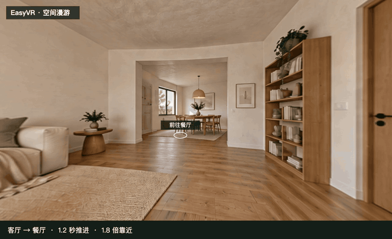
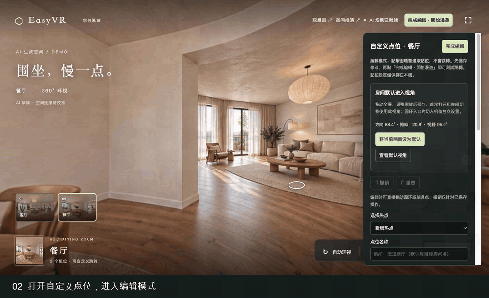

# EasyVR

本地 VR 全景取景、热点漫游与人物空间推演工具，支持全景素材导入、多位置连接、取景保存，以及人物、灯光和摄影机的空间编排。

## 启动

需要 Node.js 18+（推荐 Node.js 22）。

```sh
npm ci
npm run dev
```

默认地址：http://127.0.0.1:5182/ 。

- `/` 或 `/?panorama=1`：全景取景器。导入 2:1 全景图片、保存取景、导出 PNG、创建多个位置及跳转热点、体验三点漫游。
- `/?tour=ai-demo`：AI 客厅与餐厅双点漫游，预设往返点位，支持热点编辑和进入机位设置。取景器顶部也可点击「AI 双点漫游」进入。
- `/?tour=home`：项目自带住宅全景浏览。
- `/?editor=1&backdrop=home`：住宅全景背景下的人物站位、走位、灯光、机位与截图。
- `/?editor=1`：独立三维场景编辑器。

## 漫游与点位设置

演示入口：[双向漫游视频](docs/demos/hotspot-navigation.mp4) · [点位设置视频](docs/demos/hotspot-settings-guide.mp4) · [点位设置动图](docs/demos/hotspot-settings-guide.gif)

打开 [AI 双点漫游](http://127.0.0.1:5182/?tour=ai-demo)，拖动画面环视，点击地面圆环前往另一个房间。热点切换先轻转向，再用 **1.2 秒、最高 1.8 倍**的推进过渡进入目标机位；相邻场景会提前加载。

### 双向漫游



[播放高清示例（MP4）](docs/demos/hotspot-navigation.mp4)

### 点位设置演示

1. 点击右上角「自定义点位」，选择已有热点，或新增热点。
2. 拖动圆环或使用「在画面上选位置」，设置目标房间、外观及大小。
3. 使用「进入目标房间设置机位」调整进入方向、俯仰和视野，再保存热点。
4. 点击「完成编辑・开始漫游」，再点击圆环测试跳转。编辑模式下点击圆环会选中点位。



[播放设置教程（MP4）](docs/demos/hotspot-settings-guide.mp4)

漫游示例为 EasyVR 实际全景画面与推进效果录制；设置教程由操作截图组成，单独展示打开面板、核对参数与保存。也可保存房间默认视角、添加信息标签、撤销或重做，以及导入、导出 JSON 配置。

## 本机数据与工程

全景位置、图片及取景保存在当前浏览器的 IndexedDB `easyvr.panorama`；三维工程使用 `easyvr.spatial.*` localStorage，界面语言使用 `easyvr.ui.language`。素材在本机处理。

AI 双点漫游的配置独立保存在 localStorage `easyvr.tour:ai-demo:routes:v1`。首次打开会加载预设的往返点位，后续优先使用本机保存的设置；可通过编辑面板的「配置导入 / 导出」备份。

三维工程支持 JSON 导入与导出。全景取景器可导入图片，建立多个位置并配置跳转热点；使用同一浏览器与访问地址，可继续编辑本机保存的内容。

## AI 住宅示例

项目提供 AI 生成的住宅全景，可用于全屏浏览与人物空间推演。人物比例和地面位置支持手动校准，便于调整站位与构图。

示例素材保存在 `public/panoramas/ai-living-room.png`（1774 × 887，2:1），生成于 2026-10-13。生成提示词见 [素材记录](docs/panorama-asset.md)。

双点漫游的两张 AI 全景位于 `public/panoramas/ai-tour/`，预设点位与机位记录在 `src/tour/default-tour.js`。

## 验证与版本控制

```sh
npm test
npm run build
npm run preview
```

回归覆盖全景角度、画幅、热点、固定拍摄点、地面校准、场景存档、人物动作与导演调度，以及漫游配置、推进过渡、场景预加载和纹理缓存。

调试默认使用 Codex 内置浏览器。
